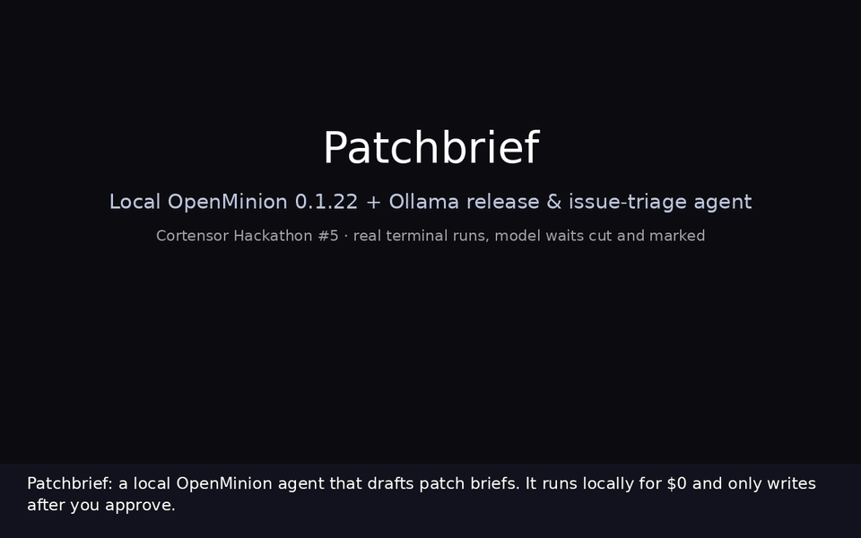

# Patchbrief — Local OpenMinion 0.1 Release & Issue-Triage Copilot

> Built for **Cortensor Hackathon #5 — OpenMinion 0.1 Builder's Sprint** ($0 local-first OpenMinion 0.1 + Ollama build).

Patchbrief is a **local-first release and issue-triage copilot** built directly on top of the **OpenMinion 0.1 Python SDK** (`openminion==0.1.22`) and **Ollama** (`qwen2.5:1.5b` or any local tool-capable Ollama model). Point it at a local git repository, changelog folder, or issue snapshot and it drafts a structured Markdown patch brief (**Summary of Changes**, **Risk Notes**, **Suggested Test Commands**, **Release Blurb**), automatically redacts leaked secrets, tracks prior briefs in persistent JSONL memory, and gates every disk write behind an explicit human approval callback.

---

## What It Does

1. **Pre-loads local project context safely** (`_read_file_or_dir_bundle`, the same reader behind the `read_local_patch_source` `@tool`): before the model runs, Python inspects a local git repo (`git log`, `git status`, `git diff --stat`) or local Markdown/text bundle with strict path checks and automatic secret redaction (`API_KEY`, `Bearer` tokens, `sk-...`, `ghp_...`, PEM private keys).
2. **Pre-loads prior briefs** (`brief-memory.jsonl`, the same store behind the `load_previous_briefs` `@tool`): Python injects recent briefs into the prompt so new release notes stay consistent across versions and sessions.
3. **Approval-gated disk writes** (`write_patch_brief` `@tool` + OpenMinion `approval_callback`): every write into `--out-dir` checks path traversal containment AND requires explicit approval (`--approve-write`, `--deny-write`, or interactive `[y/N]` prompt). If denied, nothing is written to disk.
4. **Checks the brief it wrote** (`patchbrief/quality.py`): every open issue ID in the source must be cited, and the Release Blurb must be 1-2 plain sentences that name at least one real change from the commit subjects, without claiming an open issue is fixed. The checks are deterministic and never generate text.
5. **One honest blurb repair**: if the written brief fails a blurb check, Patchbrief asks the model once (in a sibling session `<session>-blurb`) for a new blurb from the commit list. The reply is used only if it passes the same checks, and it is saved through the same approval-gated `write_patch_brief` tool. The run JSON reports `initial_quality_warnings`, `blurb_repair` (`not_needed` / `accepted` / `rejected` / `failed`) and the final `quality_warnings`.
6. **Stops the turn as soon as the write is done or denied**: `write_patch_brief` (and a denied approval) sets the `cancel_event` passed to `Agent.run`, so OpenMinion's tool loop doesn't keep re-prompting the model (`stopped_after_tool: true` in the run JSON).
7. **Runs 100% locally with Ollama**: no paid API keys, no cloud LLM calls, no wallet connections.

## Demo



Real terminal runs from a fresh clone (recorded with asciinema, rendered by `demo/render.py`). Model waits longer than 8 s are cut to 2 s and marked on screen as `[model wait cut: Ns]`; the cut list is in `demo/cuts.json`. The narrated MP4 is hosted separately (link in the submission).

---

## Architecture

```text
Local Git Repo / Release Folder
        │
        ▼
patchbrief/security.py      (secret redaction + safe path containment)
        │
        ▼
patchbrief/agent.py         (OpenMinion 0.1 Agent SDK + Ollama provider)
  ├── pre-load: source bundle + brief memory -> prompt (Python, before the model runs)
  ├── @tool read_local_patch_source (registered, read-only, secret-redacted)
  ├── @tool load_previous_briefs    (registered, read-only JSONL memory)
  └── @tool write_patch_brief       (called by the model; approval-gated + safe output dir + memory append,
                                     sets cancel_event so the turn ends right after the write/deny)
        │
        ▼
patchbrief/quality.py       (issue-ID + Release Blurb checks; one model blurb repair if they fail)
        │
        ▼
out/<filename>.md + out/brief-memory.jsonl
```

---

## Setup & Reproduction (100% Local, $0)

### 0. Clone
```bash
git clone https://github.com/yrndeen/patchbrief.git
cd patchbrief
```

### 1. Install Ollama & load a local model
```bash
# Start Ollama locally (default http://127.0.0.1:11434)
ollama serve

# REQUIRED: pull the base model, then build the 16k-context tag from the repo's Modelfile.
# The base tag's default context (4096) truncates OpenMinion's system + tool prompt.
ollama pull qwen2.5:1.5b
ollama create qwen2.5:1.5b-16k -f Modelfile
ollama show qwen2.5:1.5b-16k --parameters   # expect: num_ctx 16384
```

### 2. Install Patchbrief + OpenMinion 0.1 in a virtual environment
```bash
python3 -m venv .venv
source .venv/bin/activate
pip install -e ".[dev]"
```

### 3. Bootstrap & verify OpenMinion 0.1
```bash
openminion --home-root ./om-home setup --provider ollama --model qwen2.5:1.5b-16k --no-chat
openminion --home-root ./om-home doctor --check-turn
```
Expected: `[OK] runtime.bootstrap` and `[OK] agent.turn_smoke` (exit `0`).

### 4. Run tests & CLI
```bash
# Unit & security tests (offline, deterministic)
pytest -v

# Health check
patchbrief doctor --home-root ./om-home

# Live Ollama run — DENY write (verifies approval gate blocks disk write)
patchbrief run fixtures/sample-release \
  --home-root ./om-home \
  --out-dir ./out \
  --filename denied-check.md \
  --session demo-deny-1 \
  --deny-write

# Live Ollama run — APPROVE write (writes Markdown brief + records memory)
patchbrief run fixtures/sample-release \
  --home-root ./om-home \
  --out-dir ./out \
  --filename v0.4.2-brief.md \
  --session demo-approve-1 \
  --approve-write

# Inspect saved brief history
patchbrief history --out-dir ./out
```

On this box (8 CPU cores, Ollama v0.40.17, `qwen2.5:1.5b-16k`) a deny run takes about 65 s and an approve run about 65-90 s (the upper end when the blurb repair runs). Times vary with machine load.

Expected approve JSON (abridged): `"ok": true`, `"written_path": ".../out/v0.4.2-brief.md"`, `"quality_warnings": []`, `"stopped_after_tool": true`. Expected deny JSON: `"write_denied": true`, `"written_path": null`, and no `denied-check.md` on disk.

---

## Building Blocks Tested (OpenMinion 0.1.22)

| OpenMinion 0.1 Building Block | How Patchbrief Exercises It | Verified Result |
|---|---|---|
| **CLI Setup & Doctor** (`setup`, `doctor --check-turn`) | Non-interactive Ollama provider bootstrap (`--home-root`) + live turn smoke test | `exit 0` (`runtime.bootstrap` + `agent.turn_smoke` OK) |
| **Programmatic Python SDK** (`Agent`, `Agent.run`, `AgentRunResult`, `ProviderError`, `TurnTimeoutError`) | `PatchbriefRunner` manages agent lifecycle, session IDs, timeouts, and clean error diagnostics | Tested in live Ollama runs + unit tests |
| **Custom `@tool` Functions** | 3 local tools registered: `read_local_patch_source`, `load_previous_briefs`, `write_patch_brief` | All 3 registered with OpenMinion; the model calls `write_patch_brief`. Source and memory are pre-loaded by Python (run JSON reports `context_preloaded` / `memory_preloaded`), because a 1.5B model skips read tools |
| **Approval / Safety Gate** (`approval_callback`) | Interactive `[y/N]` + `--deny-write` / `--approve-write` gating before `write_patch_brief` | Verified: `--deny-write` blocks file creation; `--approve-write` writes file |
| **Session & Persistent Memory** (`session_id` + `brief-memory.jsonl`) | Each run uses its own OpenMinion session id; prior briefs are read back from `brief-memory.jsonl` into the next prompt | `brief-memory.jsonl` read-back verified; reusing one OpenMinion session across runs is not tested |
| **Turn cancellation** (`Agent.run(cancel_event=...)`) | The write tool and the deny path set the event so the turn ends after the one action that matters | Verified live: `stopped_after_tool: true` |
| **Local Ollama Provider** | Local `127.0.0.1:11434` inference with `qwen2.5:1.5b-16k` (in-repo `Modelfile`, `num_ctx 16384`) | Verified end-to-end with $0 API cost |

---

## What We Learned (Real OpenMinion 0.1.22 Field Notes)

These are real, reproducible findings from building and running Patchbrief against `openminion==0.1.22` + Ollama `v0.40.17`:

1. **Ollama's default `num_ctx=4096` truncates OpenMinion's system/tool prompt.**
   OpenMinion 0.1.22 sends ~3,998 tokens of system + built-in tool definitions on the first turn. With Ollama's default 4096 context window, the prompt gets truncated and triggers OpenMinion's freshness guardrail (`Missing live-data evidence`). Setting `PARAMETER num_ctx 16384` in the Ollama Modelfile resolves this cleanly.
2. **`approval_callback` receives 3 positional arguments at runtime.**
   Passing a single-argument callback raises `TypeError` when a tool requests approval. Accepting `*args, **kwargs` keeps the approval callback forward-compatible across OpenMinion 0.1 point releases.
3. **An unhandled exception inside `approval_callback` can leave an orphan tool call in the SQLite session.**
   When `approval_callback` threw `TypeError` mid-turn, reusing the same `session_id` on the next run failed with `ProviderError: INVALID_ARGUMENT: Tool transcript invariant failed`. Guarding `approval_callback` and isolating failed sessions prevents transcript corruption.
4. **Small CPU-friendly local models (1.5B–3B) benefit from grounded prompts + approval-gated fallback.**
   Models like `qwen2.5:1.5b` reliably trigger `write_patch_brief` when grounded with secret-redacted source context and prior memory, and our `assisted_fallback` path ensures that if a smaller model outputs raw Markdown without invoking the write tool, it still passes through the exact same approval-gated `write_patch_brief` `@tool` and path-containment checks.
5. **Secret redaction must happen before model ingestion AND before disk output.**
   Local repos and issue snapshots frequently contain accidentally pasted tokens (`sk-...`, `ghp_...`, `API_KEY=...`). Running `redact_secrets()` on both tool reads and final output guarantees no secret reaches the model prompt, logs, or generated Markdown brief.

---

6. **OpenMinion 0.1.22's `answer_directly` freshness guardrail (`entry.py:215-250`, `policy.py:286`) can false-positive on small local models.**
   When a 1.5B local model answers directly instead of calling a tool, it may populate `freshness.domain="regulation"` + `needs_live_data=true`, causing OpenMinion to replace the response with *"I couldn't provide a grounded current regulation answer..."*. Patchbrief both instructs the model to call `write_patch_brief` directly and explicitly detects/blocks that guardrail string so an error message is never written to disk as a release brief.

7. **After a successful tool call, OpenMinion's unforced tool loop keeps going.**
   `services/agent/execution/unforced/loop.py` re-prompts the model after every tool batch (`finish_iteration` -> follow-up request), up to `runtime.agent_loop_max_steps` (default 100). A 1.5B model then calls `write_patch_brief` again with slightly different arguments (not caught by the duplicate-signature check), so one run wrote the brief three times and only ended at the 300 s turn timeout. Passing a `threading.Event` as `Agent.run(cancel_event=...)` and setting it inside the tool ends the turn right after the write; OpenMinion raises `RuntimeError("Turn cancelled.")`, which Patchbrief treats as a normal stop only when it set the event.
8. **A turn cancelled right after a tool call can't be continued in the same session.**
   The cancelled batch has no persisted tool result, so the next `Agent.run` on that `session_id` fails with `ProviderError: INVALID_ARGUMENT ... (Tool transcript invariant failed)` (`modules/llm/transcript.py`). Patchbrief runs its blurb repair in a sibling session (`<session>-blurb`) instead.
9. **Prompt wording can trip the freshness guardrail.**
   A repair prompt containing "failed these checks" and "Current blurb" was classified as a time-sensitive regulation question and replaced with the guardrail message. Keeping the prompt to "write a release blurb for these local commits" and rejecting guardrail text in the blurb check fixed it.

---

## License

MIT — see [LICENSE](./LICENSE).
